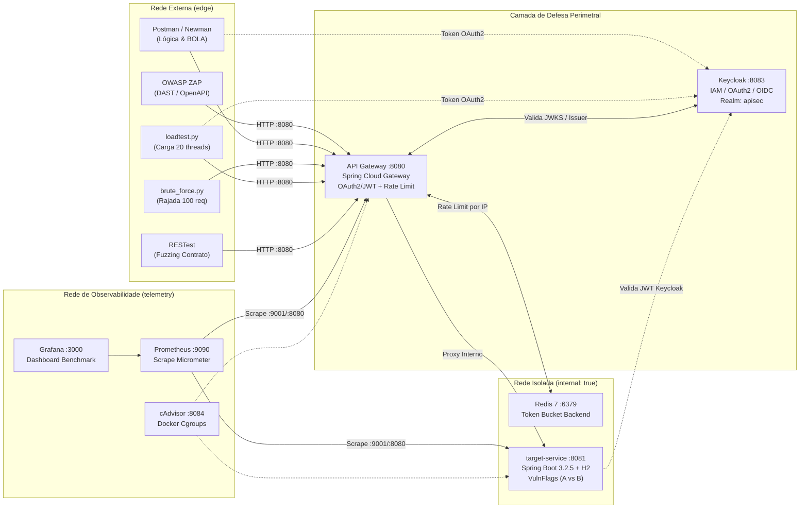

# 🛡️ APISec Testbed — Benchmarking Empírico de Segurança de APIs em Microsserviços

[](https://openjdk.org/)
[](https://spring.io/projects/spring-boot)
[](https://docs.docker.com/compose/)
[](https://www.keycloak.org/)
[](https://owasp.org/API-Security/)
[](https://www.python.org/)

> **Disciplina:** Segurança em Redes de Computadores — Prof. Hugo Kuribayashi (**Unifesspa**)  
> **Base Teórica:** Evolução empírica controlada do mapeamento sistemático de **Mendes et al. (2025)**.

Enquanto levantamentos bibliográficos medem a *popularidade* de ferramentas e estratégias de segurança na literatura, este testbed implementa um **ambiente controlado e reproduzível** para medir empiricamente:
1. **Eficácia de Detecção** (`TPR/Recall`, `Precisão`, `FDR` e `F1-Score`) de diferentes classes de ferramentas de teste de segurança;
2. **Eficácia de Mitigação** (redução de vulnerabilidades e controle de regressões) das defesas arquiteturais;
3. **Custo Operacional (Overhead)** em latência (`p50`, `p90`, `p95`, `p99`), vazão (`RPS`), `CPU (%)` e memória `RAM (MiB)`.

---

## 🏗️ Arquitetura do Sistema

O ambiente é orquestrado via [`docker-compose.yml`](apisec-testbed_1/apisec-testbed/docker-compose.yml) e segmentado em **três redes Docker isoladas** (`edge`, `internal` e `telemetry`), garantindo que **100% das requisições de teste atravessem obrigatoriamente o API Gateway** (o microsserviço alvo não publica portas no host).



### Containers, Portas e Limites de Recursos (*cgroups*)

| Container | Tecnologia | Porta no Host | Limite de Recursos | Função na Arquitetura |
| :--- | :--- | :---: | :---: | :--- |
| `apisec-gateway` | Spring Cloud Gateway (WebFlux) | `8080` | `1.0 CPU` / `1 GB RAM` | Único ponto de entrada; valida JWT (Keycloak) e aplica Rate Limiting (Redis). |
| `apisec-target` | Spring Boot 3.2.5 + H2 | *(interna `8081`)* | `1.0 CPU` / `1 GB RAM` | Sistema Sob Teste (SUT) com 10 falhas injetadas controladas por `VulnFlags`. |
| `apisec-keycloak` | Keycloak 24.0.3 | `8083` | — | Provedor OAuth2/OIDC (Realm `apisec`, usuários `alice`, `bob`, `admin`). |
| `apisec-redis` | Redis 7 Alpine | *(interna `6379`)* | — | Backend do algoritmo *Token Bucket* (`RequestRateLimiter` por IP). |
| `apisec-prometheus` | Prometheus v2.52.0 | `9090` | — | Coleta métricas JVM/Micrometer do Gateway e do Target Service. |
| `apisec-grafana` | Grafana 10.4.3 | `3000` | — | Dashboard provisionado **APISec Benchmark** (`admin` / `admin`). |
| `apisec-cadvisor` | Google cAdvisor v0.49.1 | `8084` | — | Telemetria de CPU, memória e rede dos *cgroups* dos containers. |

---

## 🧪 Desenho Experimental e Controle de Variáveis

Para garantir rigor científico (**validade interna**), **um único artefato binário** do `target-service` é executado em duas condições experimentais. A **estratégia de defesa** é a única variável independente, alternada via arquivos de ambiente ([`.env.vulneravel`](apisec-testbed_1/apisec-testbed/.env.vulneravel) vs. [`.env.protegido`](apisec-testbed_1/apisec-testbed/.env.protegido)):

| Dimensão Experimental | Perfil A — `VULNERÁVEL` (Controle) | Perfil B — `PROTEGIDO` (Tratamento) |
| :--- | :--- | :--- |
| **Autenticação Perimetral** | Desligada (`GATEWAY_ENFORCE=false`, apenas roteamento) | Ativa (`GATEWAY_ENFORCE=true`, JWT validado contra Keycloak) |
| **Rate Limiting (Redis)** | Virtualmente ilimitado (`100.000 req/s`, burst `200.000`) | Ativo por IP (`20 req/s`, burst `40`, retorno `HTTP 429`) |
| **Consultas SQL (`Product`/`Auth`)** | Concatenação direta de strings (`VULN_SQLI=true`) | `PreparedStatement` + whitelist de ordenação + parse numérico |
| **Autorização (`OrderController`)** | Sem checagem de dono + expõe `card_last4` (`VULN_BOLA=true`) | Valida `owner == subject` / `ROLE_ADMIN` (retorna `404`) + omite `card_last4` |
| **Diagnóstico, CORS e Erros** | `/api/debug/*` aberto, CORS `*` c/ credenciais, stack trace | `denyAll()` em debug, porta interna `9001`, CORS restrito, sem trace |

---

## 🎯 Perfil de Ataques e Gabarito Oficial (OWASP API Top 10: 2023)

O gabarito oficial ([`analysis/ground_truth.json`](apisec-testbed_1/apisec-testbed/analysis/ground_truth.json)) define **10 vulnerabilidades injetadas**, validadas ao longo de **10 rodadas completas (`r1` a `r10`)** em ambos os perfis:

| ID | OWASP / CWE | Classe da Vulnerabilidade | Rota Alvo | Vetor / Payload de Teste | Vulnerável (`10x`) | Protegido (`10x`) |
| :--- | :--- | :--- | :--- | :--- | :---: | :---: |
| `VULN-SQLI-01` | `API8` / `CWE-89` | SQL Injection (Busca) | `GET /api/products/search` | `q=' OR '1'='1` | `10/10` Exposta | `10/10` Mitigada |
| `VULN-SQLI-02` | `API8` / `CWE-89` | SQL Injection (Path ID) | `GET /api/products/{id}` | `id=1 OR 1=1` | `10/10` Exposta | `10/10` Mitigada |
| `VULN-SQLI-03` | `API8` / `CWE-89` | SQL Injection (Login) | `POST /api/auth/login` | `username: "admin' --"` | `10/10` Exposta | `10/10` Mitigada |
| `VULN-BOLA-01` | `API1` / `CWE-639` | Broken Object Level Auth (BOLA) | `GET /api/orders/{id}` | Token de `alice` lê pedido `2` (`bob`) | `10/10` Exposta | `10/10` Mitigada |
| `VULN-BOLA-02` | `API3` / `CWE-213` | Excessive Data Exposure | `GET /api/orders/{id}` | Exposição de `card_last4` no JSON | `10/10` Exposta | `10/10` Mitigada |
| `VULN-AUTH-01` | `API2` / `CWE-307` | Broken Auth (Sem Rate Limit) | `POST /api/auth/login` | Rajada paralela de 100 logins | `10/10` Exposta | `10/10` Mitigada |
| `VULN-AUTH-02` | `API2` / `CWE-203` | User Enumeration | `POST /api/auth/login` | `"senha incorreta"` vs `"usuario inexistente"` | `10/10` Exposta | `10/10` Mitigada |
| `VULN-MISC-01` | `API8` / `CWE-16` | Debug / Actuator Exposto | `GET /api/debug/config` | Vazamento de `jwt_secret` e `env` | `10/10` Exposta | `10/10` Mitigada |
| `VULN-MISC-02` | `API8` / `CWE-942` | CORS Permissivo c/ Credenciais | `GET /api/products` | `Origin: https://evil.example` | `10/10` Exposta | `10/10` Mitigada |
| `VULN-MISC-03` | `API8` / `CWE-209` | Stack Trace Vazado | `GET /api/debug/error` | HTTP `500` com stack trace Java | `10/10` Exposta | `10/10` Mitigada |

---

## 📊 Resultados Empíricos Consolidados

### 1. Acurácia de Detecção por Ferramenta (Etapa B — 4 Ferramentas)

| Ferramenta | Perfil | TP | FP | FN | Regressões | TPR (Recall) | Precisão | FDR (`1 - P`) | F1-Score |
| :--- | :--- | :---: | :---: | :---: | :---: | :---: | :---: | :---: | :---: |
| **OWASP ZAP (DAST)** | Vulnerável | `2` | `165` | `3` | `0` | `0.400` | `0.012` | `0.988` | `0.023` |
| **RESTest (Contrato — 10 seeds)** | Vulnerável | `1` | `3` | `4` | `0` | `0.200` | `0.250` | `0.750` | `0.222` |
| **Postman / Newman (Lógica)** | Vulnerável | `5` | `0` | `0` | `0` | `1.000` | `1.000` | `0.000` | `1.000` |
| **Brute Force (`brute_force.py`)** | Vulnerável | `1` | `0` | `0` | `0` | `1.000` | `1.000` | `0.000` | `1.000` |
| **OWASP ZAP (DAST)** | Protegido | `0` | `17` | `0` | **`0`** | `0.000` | `0.000` | `1.000` | `0.000` |
| **RESTest (Contrato — 10 seeds)** | Protegido | `0` | `2` | `0` | **`0`** | `0.000` | `0.000` | `1.000` | `0.000` |
| **Postman / Newman (Lógica)** | Protegido | `0` | `0` | `0` | **`0`** | `0.000` | `0.000` | `0.000` | `0.000` |
| **Brute Force (`brute_force.py`)** | Protegido | `0` | `0` | `0` | **`0`** | `0.000` | `0.000` | `0.000` | `0.000` |

### 2. Estabilidade Estatística nas 10 Rodadas ($\mu \pm \sigma$ populacional, $N=10$)

| Métrica Avaliada | Perfil `VULNERÁVEL` (`r1`–`r10` / `s1`–`s10`) | Perfil `PROTEGIDO` (`r1`–`r10` / `s1`–`s10`) |
| :--- | :---: | :---: |
| **RESTest (`s1`–`s10`) — TP / FP / FN** | `1.0 ± 0.0` / `3.0 ± 0.0` / `4.0 ± 0.0` (`VULN-SQLI-01`) | `0.0 ± 0.0` / `2.4 ± 0.7` / `0.0 ± 0.0` (`0` regressões) |
| **Força Bruta — HTTP `401` / HTTP `429`** | `100.0 ± 0.0` / `0.0 ± 0.0` (`10/10` vulnerável) | `48.1 ± 12.3` / `50.9 ± 11.8` (`10/10` bloqueado) |
| **Latência `p50` / `p95` (`GET /api/orders/1`)** | `93.42 ± 34.75 ms` / `210.80 ± 55.31 ms` | `75.01 ± 18.99 ms` / `200.90 ± 62.45 ms` |
| **Throughput / Taxa de Bloqueio (`HTTP 429`)** | `348.9 ± 14.6 RPS` / `0.0% ± 0.0%` | `357.4 ± 6.7 RPS` / `91.3% ± 3.4%` |
| **CPU Média — `apisec-gateway` / `apisec-target`** | `57.83% ± 26.94%` / `34.23% ± 20.92%` | `57.90% ± 26.77%` / `26.96% ± 14.65%` |
| **RAM Média — `apisec-gateway` / `apisec-target`** | `236.5 ± 11.7 MiB` / `216.8 ± 7.6 MiB` | `208.4 ± 10.9 MiB` / `183.4 ± 7.5 MiB` |

> **Conclusão Empírica:** Scanners DAST caixa-preta (OWASP ZAP) e fuzzers por contrato (RESTest — `10/10` seeds estáveis em `VULN-SQLI-01`) capturam falhas sintáticas, mas não detectam falhas semânticas de autorização (BOLA/API1 e Exposição Excessiva/API3), que exigem testes orientados a lógica/estado (Postman/Newman, `F1 = 1.000`) e rajadas concorrentes (`brute_force.py`, `F1 = 1.000`). No perfil protegido, as defesas combinadas eliminam 100% das 10 falhas (`0` regressões nas 4 ferramentas em todas as 10 rodadas) e ainda reduzem a CPU do microsserviço alvo sob rajada graças ao *Rate Limiting* na borda do Gateway.

---

## 📦 Artefatos e Relatórios Prontos

Todos os artefatos gerados estão versionados no repositório para ciência aberta e replicabilidade:

- 📊 **Planilha Excel Consolidada (8 abas + 6 gráficos integrados):** [`APISec-Benchmark-Completo.xlsx`](apisec-testbed_1/apisec-testbed/results/APISec-Benchmark-Completo.xlsx)
- 📈 **Relatórios Estatísticos das 10 Rodadas:** [`relatorio-10-rodadas.md`](apisec-testbed_1/apisec-testbed/results/relatorio-10-rodadas.md) | [`relatorio-10-rodadas.csv`](apisec-testbed_1/apisec-testbed/results/relatorio-10-rodadas.csv) | [`restest-repeticoes.md`](apisec-testbed_1/apisec-testbed/results/restest-repeticoes.md)
- 🌐 **Dashboard HTML de Apresentação:** [`results/index.html`](apisec-testbed_1/apisec-testbed/results/index.html)
- 🔎 **Relatórios OWASP ZAP:** [`zap-vulneravel.html`](apisec-testbed_1/apisec-testbed/results/zap-vulneravel.html) | [`zap-protegido.html`](apisec-testbed_1/apisec-testbed/results/zap-protegido.html)
- 📐 **Definição Formal das Métricas:** [`METRICAS.md`](apisec-testbed_1/apisec-testbed/METRICAS.md)

---

## 🚀 Como Executar e Replicar do Zero

### Pré-requisitos
- **Docker Desktop** (com Docker Compose v2 ativo)
- **Python 3.10+** (`pip install matplotlib openpyxl` para regenerar o Excel)
- **Git**

### 1. Clonar e subir a infraestrutura
```bash
git clone https://github.com/RobertoGabrielRW/Trabalho-do-Hugo.git
cd Trabalho-do-Hugo/apisec-testbed_1/apisec-testbed

# Subir no Perfil VULNERÁVEL (controle):
cp .env.vulneravel .env
docker compose up -d --build

# Ou subir no Perfil PROTEGIDO (defesas ativas):
cp .env.protegido .env
docker compose up -d --build
```

### 2. Executar as ferramentas de auditoria e carga
```bash
# Varredura DAST (OWASP ZAP)
docker compose --profile tools run --rm zap sh -c "cd /zap/wrk && ./run_zap.sh vulneravel"

# Testes de lógica e autorização (Postman / Newman)
docker compose --profile tools run --rm newman run /etc/newman/apisec-collection.postman_collection.json \
  --env-var base_url=http://gateway:8080 --env-var auth_url=http://gateway:8080/api/auth/login \
  --env-var 'auth_body={"username":"alice","password":"alice123"}' --env-var auth_ctype=application/json \
  --reporters cli,json --reporter-json-export /results/newman-vulneravel.json -n 12

# Teste de força bruta em rajada paralela (100 tentativas / 20 threads)
python analysis/brute_force.py --profile vulneravel --attempts 100

# Carga concorrente + Amostragem de CPU/RAM + Snapshot Prometheus
python analysis/recursos.py --profile vulneravel --scenario carga --duration 60 &
python analysis/loadtest.py --base http://localhost:8080 --profile vulneravel --duration 60
python analysis/prom_snapshot.py --prom http://localhost:9090 --profile vulneravel --minutes 15

# Consolidar métricas (TPR, Precisão, FDR, F1), visualizar no terminal e gerar Excel
cd analysis && python analyze.py --profile vulneravel --results ../results --gt ground_truth.json && cd ..
python analysis/visualizar.py
python analysis/gerar_excel.py
```

### 3. Acessar os Serviços Web Locais

| Serviço | URL | Credenciais |
| :--- | :--- | :--- |
| **Swagger UI (API via Gateway)** | `http://localhost:8080/swagger-ui/index.html` | — |
| **Grafana (*APISec Benchmark*)** | `http://localhost:3000` | `admin` / `admin` |
| **Keycloak Admin Console** | `http://localhost:8083/admin` | `admin` / `admin` (Realm `apisec`) |
| **Prometheus Web UI** | `http://localhost:9090` | — |
| **Google cAdvisor** | `http://localhost:8084/containers/` | — |

---

## 📁 Estrutura do Repositório

```text
Trabalho-do-Hugo/
├── README.md                                  # Documentação principal do projeto (este arquivo)
└── apisec-testbed_1/apisec-testbed/
    ├── docker-compose.yml                     # Orquestração dos 7 serviços + perfil tools (ZAP/Newman)
    ├── .env.vulneravel  /  .env.protegido     # Variáveis independentes dos perfis experimentais
    ├── Makefile                               # Atalhos de operação (make up-vuln, scan-zap, analyze...)
    ├── METRICAS.md                            # Unidades e fórmulas matemáticas (TPR, Precisão, FDR, F1)
    ├── services/
    │   ├── gateway/                           # Spring Cloud Gateway + OAuth2/JWT + Redis Rate Limiter
    │   └── target-service/                    # Microsserviço Spring Boot alvo (VulnFlags + Controllers)
    ├── keycloak/realm-export.json             # Realm 'apisec' com usuários alice, bob e admin
    ├── observability/                         # Configurações Prometheus + Dashboards Grafana
    ├── openapi/target-api.yaml                # Especificação OpenAPI 3.0 do SUT
    ├── scans/                                 # run_zap.sh, coleção Postman e configuração RESTest
    ├── analysis/                              # Scripts Python de análise, carga, visualização e Excel
    │   ├── ground_truth.json                  # Gabarito oficial das 10 vulnerabilidades OWASP
    │   ├── analyze.py                         # Casamento alerta ↔ gabarito e cálculo de acurácia
    │   ├── brute_force.py                     # Rajada concorrente contra /api/auth/login
    │   ├── loadtest.py                        # Gerador de carga concorrente (p50/p90/p95/p99/RPS)
    │   ├── recursos.py                        # Coletor de CPU (%) e RAM (MiB) via docker stats
    │   ├── prom_snapshot.py                   # Exportador de séries temporais do Prometheus
    │   ├── visualizar.py                      # Visualizador consolidado em tabela no terminal
    │   └── gerar_excel.py                     # Gerador da planilha APISec-Benchmark-Completo.xlsx
    └── results/                               # Relatórios brutos, 10 rodadas, RESTest, HTML e Excel
```
